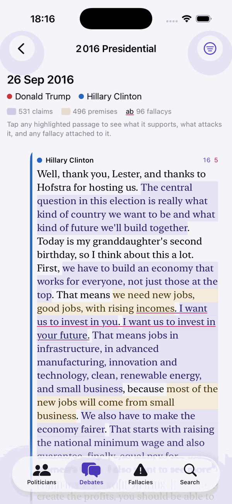
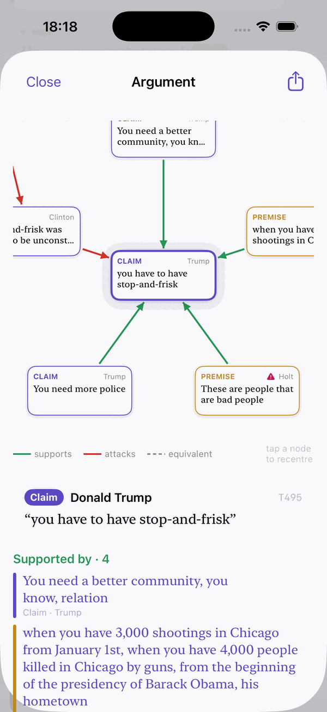
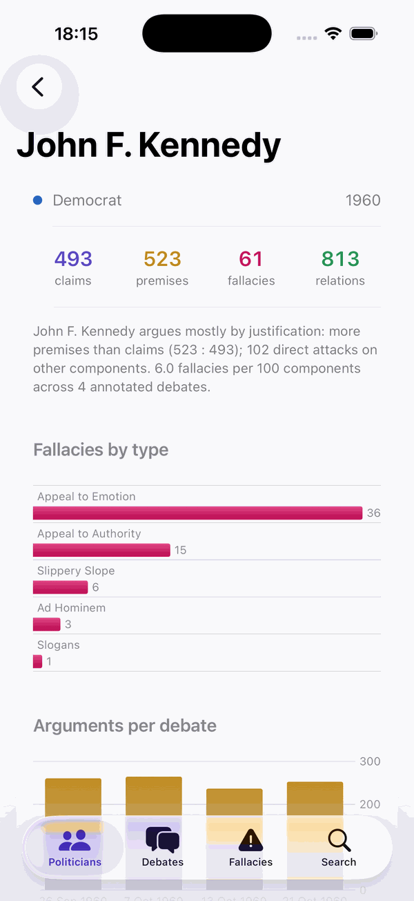
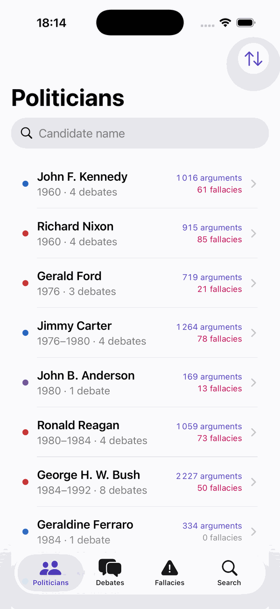
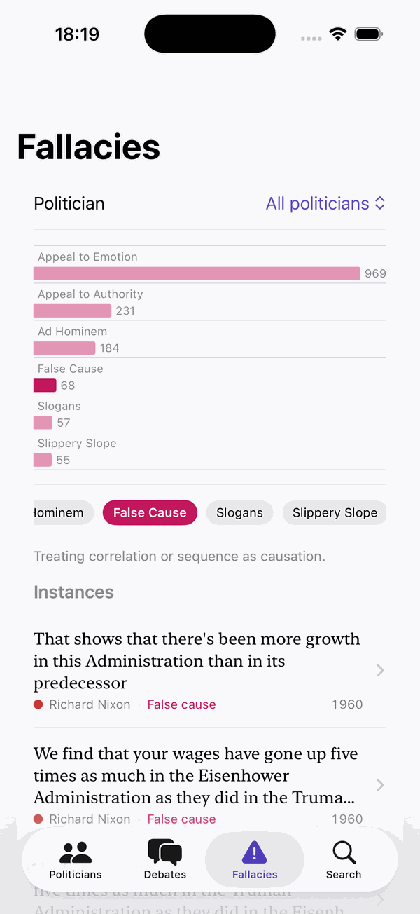
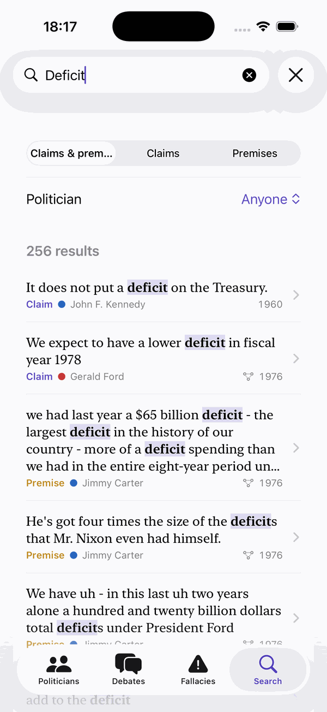

# DebateLens

**Read sixty years of US presidential debates as arguments, not just transcripts.**


DebateLens is an iOS app for journalists and fact-checkers. It shows every claim and premise a candidate made in a debate, what supports or attacks it, and which fallacies were used. It covers 46 debates from Kennedy–Nixon (1960) to Trump–Biden (2020), using the expert annotations of the **ElecDeb60to20** corpus.

<table>
  <tr>
    <td align="center" width="33%"><br><sub><b>Transcript</b> · claims, premises and fallacies inline</sub></td>
    <td align="center" width="33%"><br><sub><b>Argument sheet</b> · what supports and attacks a claim</sub></td>
    <td align="center" width="33%"><br><sub><b>Profile</b> · a candidate's argumentative style</sub></td>
  </tr>
  <tr>
    <td align="center"><br><sub><b>Politicians</b> · 33 candidates, 1960–2020</sub></td>
    <td align="center"><br><sub><b>Fallacies</b> · distribution, definitions, instances</sub></td>
    <td align="center"><br><sub><b>Search</b> · every claim and premise, all debates</sub></td>
  </tr>
</table>

## Features

**Transcript.** Each debate reads as a chat. Candidates appear left and right with a party-coloured bar, and moderators sit centred and muted. Claims are highlighted in violet, premises in ochre, and fallacies are underlined in crimson. Filters let you hide any of the three layers, keep only argumentative turns, or follow one speaker.

**Argument sheet.** Tap any highlighted passage to open its argument graph. The selected component sits in the centre, its direct relations form the first ring, and their relations form a second ring. Green arrows mean *supports*, red arrows mean *attacks*, and dashed grey means *equivalent*. Tap a node to recentre. The relation lists under the graph also work as navigation. Fallacies attached to a component are shown with their definition, and **Share** exports the quote with attribution.

**Politicians.** The list of 33 candidates can be sorted by era, name, argument volume or fallacy count. Each profile shows counts of claims, premises, fallacies and relations, a chart of fallacy types and the arguments in each debate. It ends with a one-paragraph reading of the candidate's style: whether they mostly assert or mostly justify, how often they attack directly, and how many fallacies they use per 100 components.

**Fallacies.** All 1,564 annotated fallacies, filterable by candidate and category, with the distribution and a definition of the selected category. Each instance opens the transcript at that turn.

**Search.** Full-text search over every claim and premise in every debate, filterable by type and candidate. Selecting a hit opens the transcript with the argument sheet already open.

### Design notes

- **Not annotated ≠ zero.** Fallacies are annotated in 31 of the 46 debates. Fallacy rates are computed over annotated debates only, and the other debates are labelled *not annotated*.
- **People, not labels.** `CLINTON` in 1992 and in 2016 are different people, and so is `BUSH` in 1988 and 2004. A map from (speaker label, year) to politician resolves this and adds party and role. Moderators and panelists stay visible but are never counted as politicians.
- **Two levels of fallacy annotation.** Fallacies tied to a component appear inside its argument sheet. Fallacies annotated on free text, with no component, can be tapped on their own.
- **Discontinuous spans.** Annotation spans that are split in two are rendered correctly, e.g. a claim interrupted by its own premise.
- **Provenance.** Component ids (`T495`) are visible everywhere, so any finding can be traced back to the corpus.

## Getting started

```bash
git clone https://github.com/deborahdore/DebateLens.git
open DebateLens/DebateLens.xcodeproj
```

Pick an iOS simulator and press **Run** (⌘R). The app needs Xcode 16+ and iOS 18+ (it uses `Color.mix`). The data is bundled, so there are no packages to resolve and nothing to download. The project uses Xcode 16 synchronized folders, so a new Swift file dropped into `DebateLens/` is picked up automatically.

## Data

| | |
|---|---|
| Debates | 46 (37 presidential, 9 vice-presidential), 1960–2020 |
| Speaker turns | 8,422 |
| Argument components | 33,743 (17,894 claims · 15,783 premises · 66 questions) |
| Relations | 25,745 (21,432 support · 3,791 attack · 522 equivalent) |
| Fallacies | 1,564, in 31 annotated debates |
| Politicians | 33 |

`Tools/build_dataset.py` converts the ElecDeb60to20 annotations into the JSON the app loads:

```bash
python Tools/build_dataset.py <ElecDeb60to20>/data/annotations DebateLens/Resources/Data
```

| Input | Used for |
|---|---|
| `txt/` | transcripts, turn boundaries, character offsets |
| `relations/*.ann` | components (incl. discontinuous spans) and Support / Attack / Equivalent relations |
| `fallacies/fallacies_with_span.csv` | fallacy type, subtype, text span, linked component |
| `arguments/` | debate dates |

The output is `index.json`, which holds the debate summaries and politician statistics, plus one `debates/<id>.json` per debate with its turns, components (with resolved speaker and relation lists), relations and fallacies. The total is about 17 MB. Each debate is loaded only when opened. Search and Fallacies index every debate the first time they are used, which takes a moment.

## Project layout

```
DebateLens/
  DebateLensApp.swift      tabs, routes, shared small views
  Models.swift             Codable models, colour palette
  DataStore.swift          bundle loading, caching, cross-debate queries
  PoliticianViews.swift    list, profile, charts
  DebateView.swift         transcript bubbles, inline highlighting
  ArgumentGraphView.swift  graph (Canvas), argument and fallacy sheets
  ExplorerViews.swift      fallacy explorer, search
  Resources/Data/          generated JSON
Tools/build_dataset.py     corpus → JSON converter
docs/screenshots/          README images
```

## Known issues

- About 1% of components (314 of 33,743) have character offsets that begin in the previous turn. They are attributed to the wrong speaker; for example, Trump's premise `T493` in `41_2016` is credited to the moderator. Another 107 components have no turn.
- In the argument graph, second-ring nodes can be clipped at the edges of the canvas.

## Roadmap

- **Topics across decades.** Cluster claims by subject using the SBERT embeddings already in `arguments/`, so a reader can follow *deficit* or *Iraq* from 1960 to 2020.
- **Claim reuse.** Use the `Equivalent` relation plus embeddings to find the same claim repeated across debates and years.
- **Live mode.** Run an argument-mining and fallacy-detection pipeline on a new transcript and load it in the same JSON format. The app depends on nothing beyond that format.
- **Export.** One argument graph as PDF or Markdown, ready for a fact-check piece.
- **iPad.** A three-column layout (politician / transcript / graph).

## Dataset and citation

The annotations come from ElecDeb60to20. If you use DebateLens or its data, please cite:

> Pierpaolo Goffredo, Mariana Chaves, Serena Villata, and Elena Cabrio. 2023. [Argument-based Detection and Classification of Fallacies in Political Debates](https://aclanthology.org/2023.emnlp-main.684/). In *Proceedings of EMNLP 2023*, pages 11101–11112.

```bibtex
@inproceedings{goffredo-etal-2023-argument,
  title     = {Argument-based Detection and Classification of Fallacies in Political Debates},
  author    = {Goffredo, Pierpaolo and Chaves, Mariana and Villata, Serena and Cabrio, Elena},
  booktitle = {Proceedings of the 2023 Conference on Empirical Methods in Natural Language Processing},
  pages     = {11101--11112},
  year      = {2023},
  publisher = {Association for Computational Linguistics}
}
```

## Author

Deborah Dore. Université Côte d'Azur, CNRS, Inria, I3S (MARIANNE team).
